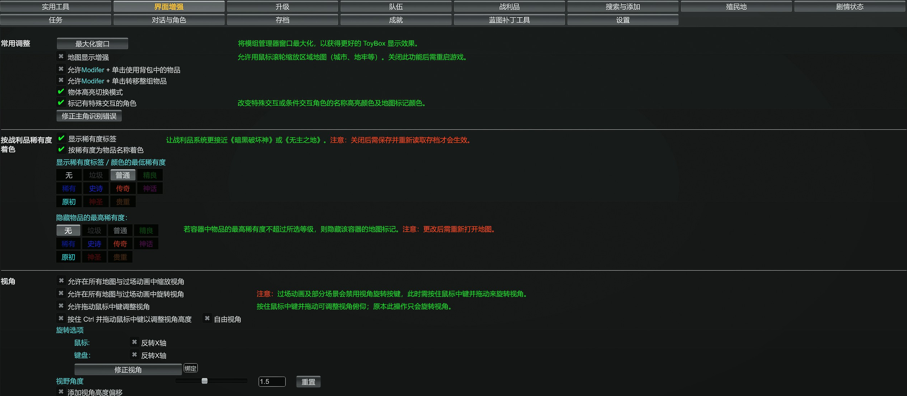
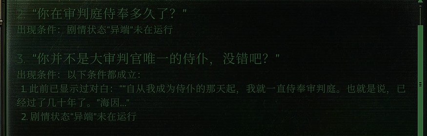

# ToyBox 行商浪人中文汉化

这两个包为《战锤 40,000：行商浪人》的 ToyBox 提供中文词表和显示说明。词表修订让菜单、术语和设置说明更容易读懂；显示增强把对话条件、结果预览和部分内部特性改成中文说明。

## 选择安装包

两个包都适用于 **ToyBox 1.7.34**，可以分别安装，也可以一起使用。

| 安装包 | 版本 | 相对原版的改进 | 安装位置 |
| --- | --- | --- | --- |
| [简体中文词表修订](dictionary-localization/README.md) | 1.0 | 将“变体”改为“职业”、“研究”改为“剧情状态”，统一游戏术语，补充菜单和设置说明。 | 替换 `0ToyBox0/Localization/zh-CN.json`。 |
| [中文显示增强](display-enhancements/README.md) | 0.2 候选版 | 将英文动作摘要写成中文结果，展开对话条件，引用相关台词，为八个内部特性补充名称或说明。 | 安装为独立 UMM 模组，与 `0ToyBox0` 并列。 |

先安装原版 [ToyBox for Rogue Trader](https://www.nexusmods.com/warhammer40kroguetrader/mods/1)，再按上表链接中的步骤安装。两个包各自负责词表和显示文本，原版 ToyBox 继续提供功能。

## 界面效果

### 菜单与设置说明

词表修订统一了页面名称，也补充了设置的用途和生效步骤。下图中，战利品稀有度、地图标记和视角操作都有对应的中文说明。

### 对话条件

原来需要辨认 `Cue Seen` 和 `Heresy` 等内部名称的地方，现在可以直接看相关台词和剧情状态。单条条件写成一句话，多条条件分行列出。

图中的单条件为“出现条件：剧情状态‘异端’未在运行”；另一条选项列出此前显示过的对白，以及同一剧情状态要求。

## 使用设置

在 ToyBox 的“设置”页选择简体中文（`zh-CN`）。游戏语言也选择简体中文后，任务、目标及其他游戏内容会显示官方中文名称。对话预览的开启位置见[显示增强安装说明](display-enhancements/README.md#安装)。

## 署名与许可

ToyBox 由 Narria、ADDB 及上游贡献者开发。原简体中文贡献者包括 ohZbs、Kirie、lhr7324925；词表修订与显示增强由 **mitcheese** 制作。

采用 MIT 许可，详见 [LICENSE.txt](LICENSE.txt) 和 [CREDITS.md](CREDITS.md)。
