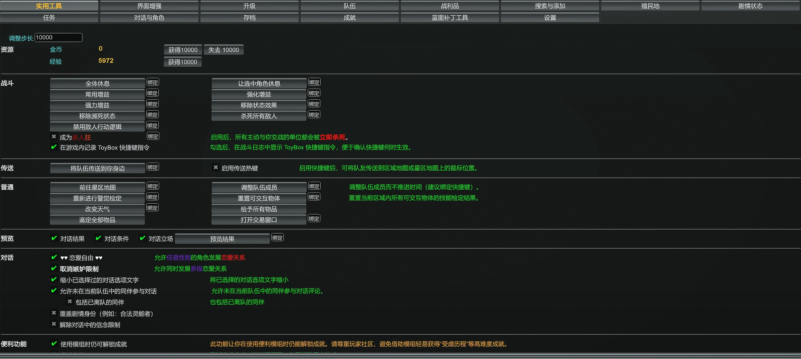

# ToyBox 简体中文词表修订

为《战锤 40,000：行商浪人》的 ToyBox 修订简体中文词表。菜单中的“变体”“研究”分别改为“职业”“剧情状态”，属性、灵能和信念名称采用游戏中的中文用语，并补充多处按钮与设置说明。

## 版本与依赖

- 汉化包：**1.0**。
- 适用模组：**ToyBox 1.7.34**，先安装原版 [ToyBox for Rogue Trader](https://www.nexusmods.com/warhammer40kroguetrader/mods/1)。
- 安装方式：替换一个中文词表文件。对话预览和特性说明还可以搭配 **ToyBox 中文显示增强 0.2** 使用。

## 安装

1. 确认 ToyBox 版本为 1.7.34，关闭游戏。
2. 找到现有 ToyBox 目录。Windows 默认位置为：

   ```text
   %USERPROFILE%\AppData\LocalLow\Owlcat Games\Warhammer 40000 Rogue Trader\UnityModManager\0ToyBox0
   ```

3. 将其中的 `Localization\zh-CN.json` 复制到另一个位置，保留一份备份。
4. 将安装包解压到 **`0ToyBox0` 目录**，覆盖同名词表。安装完成后的文件路径应为：

   ```text
   0ToyBox0\Localization\zh-CN.json
   ```

   从仓库安装时，复制本文件夹内的 `Localization\zh-CN.json` 到上述位置即可。
5. 启动游戏，在 ToyBox 的“设置”页选择简体中文（`zh-CN`）。游戏语言也选择简体中文后，游戏内容的名称与描述会使用官方中文。

## 相对原版的改进

### 菜单名称与常用操作

页面名称和常用按钮采用一致的译法，找功能时可以直接按用途辨认。

| 原词表 | 修订后 | 对应内容 |
| --- | --- | --- |
| 变体 | 职业 | 角色的职业选择与编辑。 |
| 研究 | 剧情状态 | 查看控制剧情进度的状态。 |
| 搜索/添加 | 搜索与添加 | 搜索游戏条目并添加到角色或物品列表。 |

同时修正把《行商浪人》写成“正义之怒”的作品名称，补充设置、联网、更新提示和常用操作按钮的译文。例如，“调整队伍成员”的说明会指出该操作可以调整队伍而不推进时间，“传送热键”的说明会交代鼠标位置如何作为目的地。



图中展示的是 ToyBox 原有操作的中文标签与说明；“预览”一栏可找到“对话结果”和“对话条件”开关。

### 角色、职业与重置加点

- 将 Archetypes 统一译为“职业”，将属性和技能名称统一为“社交”“弹道技能”“意志”等游戏用语。
- 写清从 0、15、35 级开始重置加点的区别，以及重新选择职业时需要注意的事项。
- 补充头像、外观和角色编辑选项的中文标签，方便找到对应设置。

### 灵能与战斗机制

- 使用“士气”“灵能等级”“障壁恶化”等名称，与游戏中的机制说明保持一致。
- 补译灵能异象、轻微与严重亚空间威胁的设置说明。
- 写清调整或固定障壁恶化值等选项的用途，方便按实际需求选择。

### 剧情状态与信念

- 将 Etudes 译为“剧情状态”，说明父子层级、触发条件和运行状态，让页面名称与它控制剧情进度的用途对应。
- 将信念名称统一为“教条主义”“自由主义”“异端主义”，便于与角色界面中的信念对照。

### 蓝图搜索与补丁管理

- 完善搜索分类、显示选项、字段类型和编辑操作的中文说明。
- 在补丁管理相关提示中写清备份与重启的时机，方便按步骤保存并应用修改。

### 战锤专名与显示设置

- 统一派系、虚空舰和装备名称，例如“亚空间引擎”“盖勒力场装置”“伺服头骨”。
- 完善体型、稀有度及颜色选项的译名。
- 补充地图标记、视角调整等设置的操作与生效说明。例如，隐藏容器标记的选项会说明稀有度阈值如何决定显示范围，以及修改后需要重新打开地图。


稀有度名称保留原有颜色，右侧说明交代选项的用途，以及保存、重读存档或重开地图等生效步骤。

部分对话、角色页和补丁编辑器的提示仍沿用原英文；对话条件与结果可以搭配中文显示增强阅读。内部名称、GUID、字段名及类型名保留原标识，方便搜索和定位。

## 更新与恢复

更新或重装 ToyBox 后，选择适配新版本的汉化包，关闭游戏并重新覆盖词表。

恢复原词表时，关闭游戏，将备份的 `zh-CN.json` 复制回 `0ToyBox0\Localization\`。也可以从原版 ToyBox 1.7.34 安装包提取该文件。

## 署名与许可

ToyBox：Narria、ADDB 及上游贡献者。原简体中文贡献者：ohZbs、Kirie、lhr7324925。词表修订：**mitcheese**。

采用 MIT 许可，详见 [LICENSE.txt](LICENSE.txt) 和 [CREDITS.md](CREDITS.md)。
