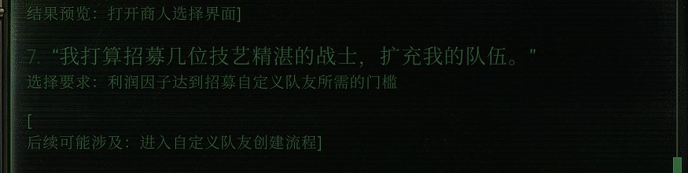
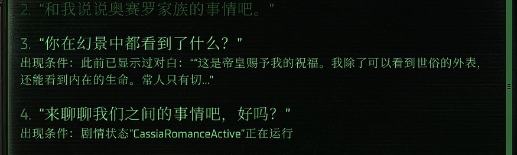
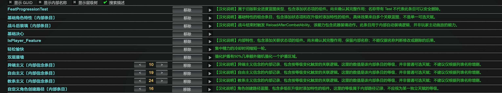

# ToyBox 中文显示增强

让《战锤 40,000：行商浪人》中 ToyBox 的对话提示更容易读懂：任务结果显示目标名称，对话条件引用相关台词，招募要求说明利润因子门槛。角色特性列表中的八个内部条目也有了中文名称或说明，方便辨认它们的用途。

## 版本与依赖

- 附加模组：**0.2 候选版**，UMM 中显示为 `0.2.0`。
- 适用版本：**ToyBox 1.7.34**，游戏 **1.6.1.514**。
- 需要原版 [ToyBox for Rogue Trader](https://www.nexusmods.com/warhammer40kroguetrader/mods/1) 和 Unity Mod Manager（UMM）。
- 可与 **ToyBox 简体中文词表修订 1.0** 一起使用，两者分别安装。

## 安装

1. 安装原版 ToyBox 1.7.34，关闭游戏。
2. 将安装包解压到现有 UMM 模组目录，使 **`ToyBoxChineseDisplayEnhancements` 与 `0ToyBox0` 并列**。Windows 默认位置为：

   ```text
   %USERPROFILE%\AppData\LocalLow\Owlcat Games\Warhammer 40000 Rogue Trader\UnityModManager\
   ├── 0ToyBox0\
   └── ToyBoxChineseDisplayEnhancements\
       ├── Info.json
       ├── ToyBoxChineseDisplayEnhancements.dll
       ├── feature-aliases.zh-CN.json
       └── story-aliases.zh-CN.json
   ```

3. 启动游戏，在 UMM 中启用 **ToyBox Chinese Display Enhancements**。
4. 将 ToyBox 界面设为简体中文（`zh-CN`），在“实用工具”的“预览”一栏开启“对话结果”和“对话条件”。游戏语言也选择简体中文后，任务与目标名称会显示官方中文。
5. 默认显示简短中文。需要查看原摘要、内部名称、GUID 和来源层级时，在本附加模组的 UMM 面板开启“显示技术详情”。选择会自动保存，提示随界面刷新更新。

## 相对原版的改进

### 对话结果：直接说明将打开什么、改变哪个目标

原来显示 `Open vendor selecting window` 的地方，改为“打开商人选择界面”；`Create custom companion` 改为“进入自定义队友创建流程”。提示直接说明动作的用途。



图中的关键提示为：

> 结果预览：打开商人选择界面
>
> 选择要求：利润因子达到招募自定义队友所需的门槛
>
> 后续可能涉及：进入自定义队友创建流程

任务提示也会使用目标与所属任务的名称。例如，`Obj6_GoToLandingZone` 对应“返回着陆区域”，并附上任务名“终末黎明之光”；动作则区分“开启目标”“完成目标”和“目标失败”。

提示用 **“结果预览”** 标出当前层的结果，用 **“后续可能涉及”** 标出后续内容。后续提示帮助查看可能涉及的结果，实际走向取决于所选分支与检定。信念变化会显示“教条主义”“自由主义”“异端主义”和带正负号的数值，检定提示会显示技能、难度及隐藏检定说明。

### 对话条件：看相关台词和要求，而不是猜内部编号

**“出现条件”** 说明选项何时会出现在对话中，**“选择要求”** 说明选择它需要具备什么条件。例如，`Has enough money for custom companion` 现在说明的是招募所需的利润因子门槛。

单条条件直接写成一句话，多条条件按“以下条件都成立”或“满足以下任一组”分行显示。原来的 `And[2]`、`And[3]` 会展开具体条件，方便看清它们之间的关系。


图中第一条选项显示“出现条件：剧情状态‘异端’未在运行”；第二条列出此前显示过的对白和剧情状态要求。“异端”是本包为 `Heresy` 提供的中文别名，“未在运行”描述的是该状态当前的运行情况。

`Cue Seen [Cue_0019]` 这类提示会引用关联对白的开头，玩家可以直接辨认是哪段话。提示还会区分本次对话与此前记录，较长的台词显示前 40 个字符。



例如，图中的“此前已显示过对白”引用了“这是帝皇赐予我的祝福……”这段台词；剧情状态仍以“正在运行”等中文说明显示。保留的内部名称可以配合技术详情用于定位。

### 特性说明与搜索：辨认内部条目的用途

角色的特性列表中，部分条目原来只有内部名称。现在名称和描述区域提供以下说明：

| 原名称 | 中文显示或说明 |
| --- | --- |
| `CorruptionSoulMark_Base`、`HopeSoulMark_Base`、`FaithSoulMark_Base` | 异端主义、自由主义、教条主义的内部信念条目，说明列表数值记录的是内部等级。 |
| `BaseCharacterFeatures` | 基础角色特性，说明它包含多个关联特性。 |
| `ReloadAfterCombat_Feature` | 战斗后装填，说明它关联的战斗结束装填逻辑。 |
| `CustomCharacterChargenPath` | 自定义角色创建路径，说明它记录角色创建时的关联特性。 |
| `IsPlayer_Feature`、`FeatProgressionTest` | 保留名称，在描述区域补充关联状态项或旧版职业进度类型的说明。 |



游戏已有的名称和描述优先显示，本包补充的内容标为 **“汉化说明”**。搜索可以使用中文名称、原内部名或 GUID；开启“搜索描述”后，还可以搜索说明文字。“显示内部名称”可在中文名称旁保留原标识，便于对照查找。

当前覆盖任务目标、剧情状态、对白记录、商人及自定义队友等提示，以及上表中的八个特性条目；其余类型沿用 ToyBox 原摘要。

## 更新与恢复

从 0.1 升级时，关闭游戏，将 0.2 文件覆盖到同一个 `ToyBoxChineseDisplayEnhancements` 文件夹。显示偏好会保留。

在 UMM 中关闭本附加模组，即可恢复 ToyBox 原显示。切换后重新打开相关列表或对话界面。回退到 0.1 时，关闭游戏并用 0.1 安装包覆盖该文件夹；卸载时移除这个文件夹即可。

更新 ToyBox 后，选择与新版本对应的显示增强包。

## 署名与许可

附加模组作者：**mitcheese**。ToyBox 由 Narria、ADDB 及上游贡献者开发，完整署名见 [CREDITS.md](CREDITS.md)。

采用 MIT 许可，详见 [LICENSE.txt](LICENSE.txt)。
